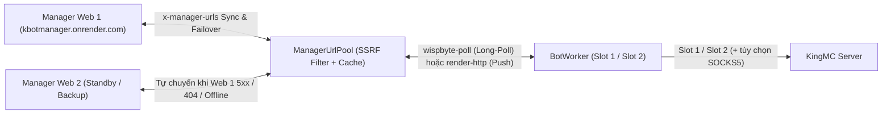

# KingMC BotWorker (V12.1.1)

**KingMC BotWorker** là tiến trình Worker Node.js sử dụng **Mineflayer** để treo AFK Minecraft 24/7 trên **KingMC**, nhận cấu hình/tài khoản đã mã hóa và lệnh điều khiển từ [KingMC Worker Manager](https://github.com/kietpro352010/Manager). Hỗ trợ **1 hoặc 2 bot độc lập (Dual-Slot)**, xác thực **ID-Only** (chỉ cần `WORKER_ID`, không cần Secret) và **tự động khám phá + failover nhiều Web Manager** (mặc định `https://kbotmanager.onrender.com`).

---

## Kiến trúc & Cơ chế hoạt động



### 3 cơ chế cốt lõi

1. **ID-Only & Zero-Plaintext Bootstrap:**
   - Worker chỉ cần `WORKER_ID_1` (thêm `WORKER_ID_2` nếu chạy Dual-Slot) để xác thực qua header `x-manager-bot-id`; **không bắt buộc `WORKER_SECRET`** *(vẫn hỗ trợ legacy secret nếu bạn chủ động cấu hình)*.
   - Toàn bộ tài khoản Minecraft và proxy được cấu hình trên Web Dashboard Manager, mã hóa trên Supabase và chỉ nạp vào RAM qua `/api/v1/workers/:workerId/bootstrap`.
2. **Tự động nhận & chuyển đổi nhiều Manager URL (`Multi-Manager Failover`):**
   - Không bắt buộc đặt `MANAGER_URL`: mặc định dùng `https://kbotmanager.onrender.com`.
   - Sau khi kết nối thành công, Worker tự học danh sách các Web Manager đang hoạt động từ header `x-manager-urls` / trường `managerUrls`, lọc bỏ hoàn toàn IP nội bộ/private/loopback (`isPrivateOrInternalHost` chống SSRF), lưu cache ra đĩa (`kbot-manager-urls.json` hoặc `MANAGER_URL_CACHE_FILE`), và tự chuyển Web khác khi gặp lỗi mạng, `5xx` hoặc Render Free suspended HTML `404`.
3. **2 chế độ Transport (`wispbyte-poll` & `render-http`):**
   - **`wispbyte-poll`:** Worker chủ động long-poll ra ngoài (`/bootstrap`, `/poll`, `/result`, `/heartbeat`, `/events`), tự rút gọn telemetry khi trạng thái ổn định để tiết kiệm băng thông & CPU. Không cần mở port inbound.
   - **`render-http`:** Mở HTTP API nội bộ (`/api/v1/bots/:workerId/command`, `/status`) để Manager đẩy lệnh trực tiếp qua HTTPS.

---

## Yêu cầu hệ thống

- **Node.js**: `>= 20.0.0 < 25.0.0` (tối ưu trên Node 22 / Node 24).
- **Worker đã tạo trên Manager Web Dashboard** để có `WORKER_ID_1` (và `WORKER_ID_2` nếu dùng 2 bot).

---

## Biến môi trường (`.env`)

Worker tự động nạp `.env` ở thư mục chạy hiện tại (`process.cwd()`) hoặc thư mục gốc dự án qua `loadDotenvSafe()`.

### 1. Biến bắt buộc (Chỉ 1 biến cho 1 bot)

| Biến | Mô tả |
|---|---|
| `WORKER_ID_1` | ID Slot 1 do Manager cấp (2–40 ký tự: chữ thường `a-z`, số `0-9`, `_`, `-`). |

### 2. Chế độ Dual-Slot (2 Bot trên cùng 1 Server/Container)

Chỉ cần thêm `WORKER_ID_2` — Worker tự đặt `WORKER_BOT_COUNT=2` (`WORKER_ID_1` và `WORKER_ID_2` phải khác nhau).

| Biến | Mô tả |
|---|---|
| `WORKER_ID_2` | ID Slot 2 do Manager cấp. |
| `WORKER_BOT_COUNT` | `1` hoặc `2` (tự nhận diện theo sự có mặt của `WORKER_ID_2`). |

### 3. Biến tùy chọn kết nối Manager & Legacy Secret

| Biến | Mặc định | Mô tả |
|---|---|---|
| `WORKER_TRANSPORT` | Tự nhận diện | `wispbyte-poll` hoặc `render-http`. Khuyên đặt rõ `wispbyte-poll` trên Wispbyte. |
| `MANAGER_URL` | `https://kbotmanager.onrender.com` | URL HTTPS Manager ưu tiên ban đầu (hỗ trợ tên cũ `MANAGER_BASE_URL`; `http://localhost` chỉ dùng local test). |
| `MANAGER_URLS` | Trống | Danh sách các URL Manager dự phòng cách nhau bằng dấu phẩy. |
| `MANAGER_URL_CACHE_FILE` | `<os.tmpdir()>/kbot-manager-urls.json` | Đường dẫn file lưu pool Manager URL đã học. |
| `WORKER_SECRET_1`, `_2` | Trống *(ID-Only)* | Tùy chọn tương thích ngược nếu muốn siết xác thực kèm secret riêng cho bot. |
| `WORKER_PREVIOUS_SECRET_1`, `_2` | Trống | Tùy chọn secret cũ kèm `WORKER_SECRET_GRACE_UNTIL_1`, `_2` khi xoay secret. |

### 4. Biến tùy chọn Game & Tài nguyên

| Biến | Mặc định | Mô tả |
|---|---|---|
| `PORT` | Tự nhận diện | Cổng HTTP cho `/health` & `/api/v1` (ưu tiên `SERVER_PORT`, `P_SERVER_PORT`, `ALLOCATION_PORT`, `PORT`, mặc định `10000`). |
| `MC_SERVER_HOSTS` | `kingmc.vn,sgp.kingmc.vn` | Chỉ chấp nhận các host KingMC hợp lệ, cách nhau bằng dấu phẩy. |
| `MC_SERVER_PORT` | `25565` | Cổng máy chủ Minecraft (1–65535). |
| `MC_SERVER_VERSION` | `1.20.1` | Phiên bản giao thức Mineflayer. |
| `MC_VIEW_DISTANCE` | `tiny` | Tầm nhìn (`tiny`, `short`, `normal`, `far`; hỗ trợ riêng từng slot `_1` / `_2`). |
| `MC_AUTH_ENABLED` | `true` | Tự động gửi lệnh xác thực (`/login` / `/register`) khi vào sảnh. |
| `MC_AUTH_TYPE` | `offline` | `offline` hoặc `microsoft` (hỗ trợ `_1` / `_2`). |
| `MC_PROXY_URL` | Trống | URL SOCKS5 mặc định nếu không cấp qua Manager (hỗ trợ `_1` / `_2`). |
| `AUTO_START` | `false` | `true` để tự vào game ngay khi bootstrap xong; `false` để chờ lệnh Bật từ Manager. |
| `AUTO_RECONNECT` | `true` | Tự động kết nối lại theo exponential backoff khi rớt mạng hoặc bị kick. |
| `JOIN_COMMAND`, `JOIN_DELAY_MS` | Luồng menu KingSMP / `4000` | Lệnh vào cụm và độ trễ tối thiểu sau spawn. |
| `CONNECT_TIMEOUT_MS`, `RECONNECT_BASE_MS`, `RECONNECT_MAX_MS` | `40000` / `5000` / `120000` | Timeout kết nối và backoff kết nối lại (ms). |
| `AFK_ACTION_MIN_MS`, `AFK_ACTION_MAX_MS` | `180000` / `360000` | Chu kỳ thao tác chống AFK (10000–86400000 ms). |
| `WORKER_RSS_WARN_MB` | `400` | Ngưỡng cảnh báo RAM RSS (MB). |
| `WISPBYTE_COOKIE`, `WISPBYTE_PANEL_URL`, `WISPBYTE_KEEPALIVE_INTERVAL_MS` | Trống / `https://wispbyte.com/client` / `86400000` | Giữ hạn tài khoản Wispbyte từ phía Worker (tùy chọn nếu chưa cấu hình trên Manager). |
| `LOG_LEVEL` | `info` | Mức log (`debug`, `info`, `warn`, `error`). |

---

## Triển khai nhanh trên Wispbyte / Pterodactyl (Khuyên dùng)

1. Tạo Bot mới trên Manager Dashboard ở chế độ **Wispbyte (Pull Mode)** để nhận `WORKER_ID_1` (và `WORKER_ID_2` nếu chạy 2 bot).
2. Dán nội dung sau vào `/home/container/.env` trên **Wispbyte File Manager**:

**1 Bot (Single-Slot):**
```dotenv
WORKER_TRANSPORT=wispbyte-poll
WORKER_BOT_COUNT=1
WORKER_ID_1=01
NODE_ENV=production
```

**2 Bot trên cùng 1 Server (Dual-Slot):**
```dotenv
WORKER_TRANSPORT=wispbyte-poll
WORKER_BOT_COUNT=2
WORKER_ID_1=01
WORKER_ID_2=02
NODE_ENV=production
```

3. Trên Wispbyte Startup Settings:
   - Node.js image: **Node 22** hoặc **Node 24**.
   - Startup command / `JS_FILE`: `index.js` (hoặc `npm run start:wispbyte`; với container 400MB nên giữ `NODE_OPTIONS=--max-old-space-size=400`, tránh đặt `--optimize_for_size` vì làm giảm JIT và tăng CPU).
   - **Không cần** dán URL `wispbyte.com/client/servers/...` vào ô Web URL trên Manager.
4. Nhập tài khoản Minecraft trên Web Dashboard Manager rồi bật Server Wispbyte.

---

## Triển khai trên Render

1. Tạo **Web Service** trỏ tới repo `BotWorker`.
2. Cấu hình:
   - **Node.js:** `22` (hoặc `20–24`)
   - **Build Command:** `npm ci --omit=dev`
   - **Start Command:** `npm start` *(chạy `node --max-old-space-size=400 index.js`)*
   - **Health Check Path:** `/health`
3. Thêm Environment: `WORKER_TRANSPORT=render-http`, `WORKER_ID_1=01` (thêm `WORKER_ID_2=02` nếu Dual-Slot; có thể thêm `MANAGER_URL` nếu muốn ghim web chính ngoài `https://kbotmanager.onrender.com`).
4. Dán URL `https://<ten-service>.onrender.com` vào Manager Dashboard khi đăng ký Bot.

---

## Chạy cục bộ (Local Development)

```powershell
# Cài dependencies (tự chạy scripts/postinstall.js để tối ưu RAM/ổ cứng)
npm ci

# Chạy chế độ mặc định hoặc ép Wispbyte long-poll trên máy cá nhân:
npm start
npm run start:wispbyte
```

---

## HTTP Endpoints & API Contract

- `GET /`, `GET /health`: Health probe công khai (`{ ok: true, service, botCount, slots }`, không lộ `workerId`).
- `GET /ready`: Readiness probe.
- `GET /api/v1/diagnostics`: Thông số RAM/event loop và danh sách slot (xác thực `x-manager-bot-id` hoặc `x-worker-secret` nếu có secret).
- `GET /api/v1/bots/:workerId/status`: Trạng thái hiện tại của slot.
- `POST /api/v1/bots/:workerId/command`: Thực thi **15 actions** chuẩn Manager ↔ Worker (đồng thời nhận & học `x-manager-urls` từ Manager):
  `start`, `stop`, `restart`, `reconnect`, `status`, `chat`, `reset`, `set-afk-mode`, `set-proxy`, `respawn`, `inventory`, `look`, `toss`, `window_click`, `window_close`.

---

## Tính năng game & Tối ưu CPU / RAM

- **Tự động xác thực & Điều hướng sảnh KingMC:** Đợi `/login` hoặc `/register` hoàn tất rồi tự điều hướng vào cụm KingSMP.
- **Eco Mode & Lọc gói tin thông minh (`packet-optimization.js`):** Bật/tắt physics động và loại bỏ có chọn lọc các gói tin môi trường gây tốn CPU/RAM (hiệu ứng, particle, entity thừa...) trong khi **giữ nguyên 100%** gói tin cần thiết cho gameplay, túi đồ, mở/bấm Remote GUI, chat, Totem, thức ăn và đo TPS.
- **Chống AFK, Auto-Totem & Anti-Hungry:** Tự trang bị Totem vào offhand, ăn tự động và báo sự kiện (`bot_death`, `low_totem`, `afk_kicked`, `afk_recovered`, `reconnect_exhausted`) về Manager.
- **Lịch trình từ Manager & Bảo trì KingMC (04:30 – 05:30 UTC+7):** Tự đồng bộ cài đặt qua `settingsRevision`, chạy Spawn Commands, Auto-Chat, hẹn giờ Bật/Tắt và tạm nghỉ trong khung bảo trì `Asia/Ho_Chi_Minh`.
- **Memory Watchdog & Postinstall Cleanup:** Quét dọn memory theo `heap_size_limit` V8 (tránh ép GC liên tục gây spike CPU) và [`scripts/postinstall.js`](scripts/postinstall.js) loại bỏ dữ liệu Bedrock / recipe thừa khi cài đặt.

---

## Kiểm thử (Testing)

```bash
npm test
```

Chạy đầy đủ **7 bộ test** tích hợp & hồi quy:
1. `integration.test.js`
2. `remediation-audit.test.js`
3. `challenger_stress.test.js`
4. `kingmc_lobby_routine.test.js`
5. `system-optimization-and-resilience.test.js`
6. `deep-audit-fixes.test.js`
7. `multi-manager-id-only.test.js` *(ID-Only, Multi-Manager failover & bảo vệ chống đầu độc URL SSRF)*

---

## Xử lý sự cố thường gặp

| Lỗi / Log | Nguyên nhân & Cách xử lý |
|---|---|
| `WORKER_ID_1 must be configured.` | Thiếu `WORKER_ID_1` trong `.env` / Environment Variables, hoặc vẫn để chữ mẫu `replace-with` / `example`. |
| `worker_auth_check_failed` (`401` / `404`) | `WORKER_ID_n` chưa được tạo trên Manager hoặc đang bị tắt (`enabled = false`); hoặc Worker có đặt `WORKER_SECRET_n` nhưng không khớp. |
| Manager báo `405` khi gửi lệnh tới Wispbyte Worker | Trên Manager bị gắn nhầm `provider: render` với link `https://wispbyte.com/client/servers/...`. Xóa trống Web URL trên Manager Dashboard để dùng Pull mode. |
| `manager_failover_retry` / `wispbyte_manager_failover` | Web Manager đang ưu tiên tạm thời mất kết nối, `5xx` hoặc suspended HTML `404` -> Worker đang tự chuyển sang Web Manager khác trong pool. |
| `credentials_missing` | Chưa nhập Username Minecraft cho Bot trong Web Dashboard của Manager. |
| `worker_memory_high` / Container restart vì OOM | Với container RAM nhỏ (<= 256–400MB), kiểm tra đã bật **Eco Mode**, `WORKER_BOT_COUNT=1` (nếu RAM < 300MB) và `NODE_OPTIONS=--max-old-space-size=400`. |
