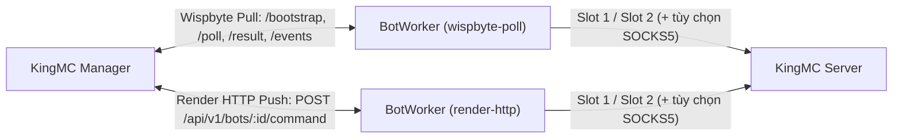

# KingMC BotWorker (V12.1.1)

**KingMC BotWorker** là tiến trình Worker Node.js sử dụng **Mineflayer** để treo AFK Minecraft 24/7 trên **KingMC**, nhận cấu hình/tài khoản đã mã hóa và lệnh điều khiển từ [KingMC Worker Manager](https://github.com/kietpro352010/Manager). Mỗi tiến trình hỗ trợ **1 hoặc 2 bot độc lập (Dual-Slot)** trong giới hạn RAM tối ưu.

---

## Kiến trúc & Cơ chế hoạt động



### 2 chế độ Transport

1. **`wispbyte-poll` (Wispbyte / Pterodactyl — Outbound Long-Polling)**:
   - Worker chủ động kết nối **đi ra** tới Manager qua `MANAGER_URL` (`/bootstrap`, `/poll`, `/result`, `/events`).
   - Không cần mở port HTTP vào (inbound) cho container và **không** cần điền URL public vào Manager.
   - Tự động nhận diện khi có biến môi trường của Pterodactyl/Wispbyte hoặc khi đặt `WORKER_TRANSPORT=wispbyte-poll`.
2. **`render-http` (Render / VPS có HTTPS công khai)**:
   - Mở HTTP API nội bộ (`/api/v1/bots/:workerId/command` và `/status`) để Manager gọi trực tiếp qua HTTPS.
   - Tự động nhận diện khi biến môi trường của Render tồn tại (`RENDER=true`, `RENDER_EXTERNAL_URL`, ...) hoặc khi đặt `WORKER_TRANSPORT=render-http`.

### Nguyên tắc bảo mật Zero-Plaintext

- Worker **không lưu** mật khẩu tài khoản Minecraft hay cấu hình SOCKS5 do Manager cấp trong `.env`.
- Toàn bộ tài khoản MC và proxy được nhập trên **Manager Dashboard**, mã hóa trong Supabase, và chỉ được tải về RAM của Worker qua endpoint `/api/v1/workers/:workerId/bootstrap` có xác thực `x-worker-secret`.

---

## Yêu cầu hệ thống

- **Node.js**: `>= 20.0.0 < 25.0.0` (tối ưu và đã kiểm thử tốt trên Node 22 / Node 24).
- **Worker đã được tạo trên Manager** để có cặp `WORKER_ID_n` và `WORKER_SECRET_n` (tối thiểu 32 ký tự).
- **URL Manager công khai HTTPS**: `MANAGER_URL` bắt buộc phải dùng `https://` khi triển khai từ xa (`http://localhost` / `http://127.0.0.1` chỉ dùng cho test cục bộ).

---

## Biến môi trường (`.env`)

Worker tự động nạp file `.env` ở thư mục chạy (`process.cwd()`) hoặc thư mục gốc dự án thông qua `loadDotenvSafe()`.

### 1. Biến bắt buộc

| Biến | Mô tả |
|---|---|
| `MANAGER_URL` | URL gốc HTTPS của Manager, ví dụ `https://your-manager.onrender.com` (không có `/` ở cuối). Hỗ trợ tên cũ `MANAGER_BASE_URL`. |
| `WORKER_ID_1` | ID Slot 1 do Manager cấp (2–40 ký tự: chữ thường `a-z`, số `0-9`, `_`, `-`). |
| `WORKER_SECRET_1` | Secret Slot 1 do Manager cấp (tối thiểu 32 ký tự). |

### 2. Chế độ Dual-Slot (2 Bot trên 1 Server/Container)

Worker tự động chạy 2 bot song song khi khai báo thêm `WORKER_ID_2` (hoặc đặt rõ `WORKER_BOT_COUNT=2`). `WORKER_ID` và `WORKER_SECRET` giữa hai slot bắt buộc phải khác nhau.

| Biến | Mô tả |
|---|---|
| `WORKER_BOT_COUNT` | `1` hoặc `2`. Nếu bỏ trống: tự là `2` khi có `WORKER_ID_2`, ngược lại là `1`. |
| `WORKER_ID_2` | ID Slot 2 do Manager cấp. |
| `WORKER_SECRET_2` | Secret Slot 2 do Manager cấp (tối thiểu 32 ký tự). |
| `WORKER_PREVIOUS_SECRET_1`, `_2` | Tùy chọn: secret cũ dùng trong 5 phút grace period khi xoay khóa (`WORKER_SECRET_GRACE_UNTIL_1`, `_2`). |

### 3. Biến tùy chọn khác

| Biến | Mặc định | Mô tả |
|---|---|---|
| `WORKER_TRANSPORT` | Tự nhận diện | `wispbyte-poll` hoặc `render-http`. Khuyến nghị đặt rõ trên Wispbyte để tránh sai lệch môi trường. |
| `PORT` | Tự nhận diện | Cổng HTTP cho `/health` & `/api/v1` (ưu tiên `SERVER_PORT`, `P_SERVER_PORT`, `ALLOCATION_PORT`, `PORT`, mặc định `10000`). |
| `MC_SERVER_HOSTS` | `kingmc.vn,sgp.kingmc.vn` | Chỉ chấp nhận các host KingMC hợp lệ, cách nhau bằng dấu phẩy. |
| `MC_SERVER_PORT` | `25565` | Cổng máy chủ Minecraft (1–65535). |
| `MC_SERVER_VERSION` | `1.20.1` | Phiên bản giao thức Mineflayer. |
| `MC_VIEW_DISTANCE` | `tiny` | Tầm nhìn (`tiny`, `short`, `normal`, `far`; hỗ trợ riêng từng slot `_1` / `_2`). |
| `MC_AUTH_ENABLED` | `true` | Tự động gửi lệnh xác thực (`/login` / `/register`) theo trạng thái máy chủ. |
| `MC_AUTH_TYPE` | `offline` | `offline` hoặc `microsoft` (hỗ trợ `_1` / `_2`). |
| `MC_PROXY_URL` | Trống | URL proxy mặc định `socks5://...` nếu không quản lý qua Manager (hỗ trợ `_1` / `_2`). |
| `AUTO_START` | `false` | `true` để bot tự vào game ngay sau khi khởi động và bootstrap xong; `false` để chờ lệnh Bật từ Manager. |
| `AUTO_RECONNECT` | `true` | Tự động thử kết nối lại theo backoff khi bị mất kết nối hoặc kick. |
| `JOIN_COMMAND` | Luồng menu KingMC | Lệnh phụ sau khi vào sảnh; bỏ trống để dùng luồng bấm menu KingSMP mặc định. |
| `JOIN_DELAY_MS` | `4000` | Độ trễ tối thiểu sau spawn trước khi điều hướng. |
| `CONNECT_TIMEOUT_MS` | `40000` | Thời gian chờ kết nối tối đa mỗi lần thử. |
| `RECONNECT_BASE_MS`, `RECONNECT_MAX_MS` | `5000` / `120000` | Độ trễ reconnect cơ bản và tối đa (ms). |
| `AFK_ACTION_MIN_MS`, `AFK_ACTION_MAX_MS` | `180000` / `360000` | Khoảng thời gian thao tác chống AFK (10000–86400000 ms). |
| `WORKER_RSS_WARN_MB` | `440` | Ngưỡng cảnh báo RAM RSS (MB). |
| `WISPBYTE_COOKIE`, `WISPBYTE_PANEL_URL`, `WISPBYTE_KEEPALIVE_INTERVAL_MS` | Trống / `https://wispbyte.com/client` / `86400000` | Cookie giữ hạn panel Wispbyte ngay từ Worker (nếu không cấu hình tập trung ở Manager). |
| `LOG_LEVEL` | `info` | Mức log JSON console (`debug`, `info`, `warn`, `error`). |

---

## Triển khai trên Wispbyte / Pterodactyl (Khuyên dùng)

1. Vào Manager Dashboard -> thêm Worker ở chế độ **Wispbyte / Pull** (hoặc không điền URL Render) để lấy `WORKER_ID_1`, `WORKER_SECRET_1` (và `_2` nếu chạy 2 bot).
2. Trên **Wispbyte File Manager**, tạo file `/home/container/.env` với nội dung:

**Mẫu 1 Bot (Single-Slot):**
```dotenv
MANAGER_URL=https://your-manager.onrender.com
WORKER_TRANSPORT=wispbyte-poll
WORKER_BOT_COUNT=1
WORKER_ID_1=01
WORKER_SECRET_1=<worker-secret-toi-thieu-32-ky-tu>
NODE_ENV=production
```

**Mẫu 2 Bot trên cùng 1 Server Wispbyte (Dual-Slot):**
```dotenv
MANAGER_URL=https://your-manager.onrender.com
WORKER_TRANSPORT=wispbyte-poll
WORKER_BOT_COUNT=2
WORKER_ID_1=01
WORKER_SECRET_1=<worker-secret-slot-1>
WORKER_ID_2=02
WORKER_SECRET_2=<worker-secret-slot-2>
NODE_ENV=production
```

3. Trong Wispbyte Startup Settings:
   - Đặt `JS_FILE` thành `index.js` (hoặc chạy `npm run start:wispbyte`).
   - Node.js image: chọn **Node 22** hoặc **Node 24**.
   - **Không cần** dán URL `https://wispbyte.com/client/servers/...` vào ô URL của bot bên Manager.
4. Nhập tài khoản Minecraft cho từng Bot ở Web Dashboard Manager rồi khởi động lại server Wispbyte để Worker bootstrap và bắt đầu polling.

---

## Triển khai trên Render

1. Tạo **Web Service** trỏ tới repository `BotWorker`.
2. Cấu hình:
   - **Node.js:** `22` (hoặc `20–24`)
   - **Build Command:** `npm ci --omit=dev`
   - **Start Command:** `npm start` *(chạy `node --max-old-space-size=384 index.js`)*
   - **Health Check Path:** `/health`
3. Thêm vào **Environment**: `MANAGER_URL`, `WORKER_TRANSPORT=render-http`, `WORKER_ID_1`, `WORKER_SECRET_1` (và `_2` nếu dùng Dual-Slot).
4. Copy URL `https://<ten-service>.onrender.com` của Render Service dán vào Manager khi đăng ký Bot.

---

## Chạy cục bộ (Local Development)

```powershell
# Cài dependencies (tự chạy scripts/postinstall.js để tối ưu RAM/ổ cứng)
npm ci

# Tạo .env rồi chạy
npm start
# Hoặc chạy chế độ Wispbyte long-poll trên máy cá nhân:
npm run start:wispbyte
```

---

## HTTP Endpoints & API Contract

- `GET /`, `GET /health`: Health probe công khai (trả về `{ ok: true, service, botCount, slots }`, không lộ `workerId` hay secret).
- `GET /ready`: Readiness probe.
- `GET /api/v1/diagnostics`: Thông số RAM/process và danh sách slot (bắt buộc header `x-worker-secret`).
- `GET /api/v1/bots/:workerId/status`: Trạng thái hiện tại của slot (bắt buộc `x-worker-secret`).
- `POST /api/v1/bots/:workerId/command`: Thực thi một trong **15 actions** chuẩn Manager ↔ Worker:
  `start`, `stop`, `restart`, `reconnect`, `status`, `chat`, `reset`, `set-afk-mode`, `set-proxy`, `respawn`, `inventory`, `look`, `toss`, `window_click`, `window_close`.

---

## Tính năng game & Tối ưu tài nguyên

- **Tự động xác thực & Điều hướng sảnh KingMC:** Đợi quá trình auth (`/login` / `/register`) hoàn tất rồi tự động thao tác menu/lệnh vào cụm KingSMP.
- **Chống AFK thông minh & Eco Mode:** Bật/tắt physics động (`ecoMode`) giảm tải CPU mạnh mẽ; lọc các gói tin chunk/entity/actionBar thừa để giảm tiêu thụ RAM.
- **Auto-Totem & Anti-Hungry:** Tự động trang bị Totem vào offhand, theo dõi thức ăn/HP và gửi sự kiện cảnh báo (`bot_death`, `low_totem`, `afk_kicked`, `afk_recovered`, `reconnect_exhausted`) về Manager.
- **Lịch trình từ Manager:** Hỗ trợ Spawn Commands, Auto-Chat định kỳ/giờ cố định và lịch Bật/Tắt/Lệnh theo chu kỳ hoặc theo khung giờ thực tế.
- **Bảo trì tự động KingMC (04:30 – 05:30 UTC+7):** Tự tạm nghỉ trong khung giờ bảo trì `Asia/Ho_Chi_Minh` và xếp hàng kết nối lại so le sau 05:30.
- **Memory Watchdog & Postinstall Cleanup:** Tự kích hoạt `global.gc()` / dọn cache khi RSS > 200MB / 350MB, và `scripts/postinstall.js` loại bỏ dữ liệu Bedrock & recipe PC không sử dụng khi cài gói.

---

## Kiểm thử (Testing)

```bash
npm test
```

Chạy đầy đủ 6 bộ test tích hợp & hồi quy: `integration`, `remediation-audit`, `challenger_stress`, `kingmc_lobby_routine`, `system-optimization-and-resilience`, `deep-audit-fixes`.

---

## Xử lý sự cố thường gặp

| Lỗi / Log | Nguyên nhân & Cách xử lý |
|---|---|
| `Error: MANAGER_URL must be configured.` | Chưa tạo `/home/container/.env` (trên Wispbyte) hoặc chưa thêm biến `MANAGER_URL` trong Environment Variables của host. |
| `WORKER_ID_1 must be configured.` / `WORKER_SECRET_1 must be at least 32 characters` | Thiếu biến hoặc secret ngắn hơn 32 ký tự / vẫn giữ chữ mẫu `replace-with` hoặc `example`. Lấy đúng ID & Secret từ Manager Dashboard. |
| `worker_auth_check_failed` (`401` / `404`) | Sai cặp `WORKER_ID_n` / `WORKER_SECRET_n` hoặc Worker chưa được tạo / đã bị tắt (`enabled = false`) trên Manager. Sau khi liên tiếp lỗi vượt ngưỡng, Worker sẽ tự pause và stop bot để bảo vệ phiên. |
| Manager báo `405` khi gửi lệnh tới Wispbyte Worker | Trên Manager bị cấu hình nhầm `provider: render` hoặc điền link `https://wispbyte.com/client/servers/...` làm Web URL bot. Hãy xóa trống URL của bot đó trên Manager Dashboard để dùng chế độ Pull. |
| `credentials_missing` | Chưa nhập Username Minecraft cho Bot trong Web Dashboard của Manager. |
| `worker_memory_high` / Container restart vì OOM | Nếu chạy container RAM rất nhỏ (<= 256MB), chuyển về `WORKER_BOT_COUNT=1` và bật **Eco Mode** trên Manager Dashboard. |
