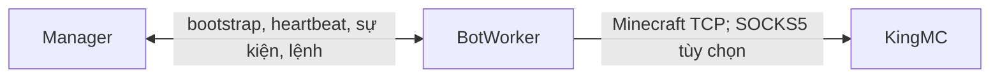

# KingMC BotWorker

Worker Node.js dùng Mineflayer để giữ bot AFK trên KingMC. Worker nhận cấu hình tài khoản và lệnh từ [Manager](https://github.com/kietpro352010/Manager); mỗi tiến trình hỗ trợ một hoặc hai bot slot.

## Yêu cầu

- Node.js 20 trở lên.
- Một Worker đã được đăng ký trong Manager.
- URL Manager công khai qua HTTPS khi Worker chạy trên host khác.
- Tài khoản Minecraft được cấu hình trong Manager. Không đặt mật khẩu Minecraft trong biến môi trường của Worker.

## Worker hoạt động thế nào



Render dùng transport HTTP. Wispbyte/Pterodactyl thường dùng long polling để Worker kết nối ra ngoài tới Manager, không cần mở cổng vào cho Worker.

## Cấu hình bắt buộc

| Biến | Bắt buộc | Mô tả |
|---|---|---|
| `MANAGER_URL` | Có | URL gốc của Manager, ví dụ `https://manager.example.com`; không thêm `/` ở cuối. `MANAGER_BASE_URL` là tên tương thích cũ. |
| `WORKER_ID_1` | Có | ID slot thứ nhất, gồm chữ thường, số, `_` hoặc `-`. |
| `WORKER_SECRET_1` | Có | Secret riêng của slot, tối thiểu 32 ký tự; lấy từ Manager. |

Slot thứ hai là tùy chọn: đặt thêm `WORKER_ID_2` và `WORKER_SECRET_2`. Nếu không đặt `WORKER_BOT_COUNT`, Worker tự dùng 2 slot khi có `WORKER_ID_2`, còn lại dùng 1. ID và secret giữa các slot phải khác nhau.

### Biến tùy chọn thường dùng

| Biến | Mặc định | Mô tả |
|---|---:|---|
| `WORKER_TRANSPORT` | Tự nhận diện | `render-http` hoặc `wispbyte-poll`. Có thể đặt rõ khi host không được tự nhận diện. |
| `PORT` | Theo host | Cổng HTTP health/status; Render và Pterodactyl thường cấp cổng qua môi trường. |
| `MC_SERVER_HOSTS` | `kingmc.vn,sgp.kingmc.vn` | Danh sách host Minecraft, phân cách bằng dấu phẩy. |
| `MC_SERVER_PORT` | `25565` | Cổng Minecraft. |
| `MC_SERVER_VERSION` | `1.20.1` | Phiên bản giao thức Mineflayer. |
| `MC_AUTH_ENABLED` | `true` | Bật xử lý đăng nhập tài khoản tại server. |
| `MC_AUTH_TYPE` | `offline` | `offline` hoặc `microsoft`; chọn phù hợp với tài khoản Minecraft. |
| `MC_PROXY_URL` | Không dùng proxy | SOCKS5 proxy dùng cho kết nối Minecraft, nếu cần. |
| `AUTO_START` | `false` | Tự kết nối sau khi bootstrap Manager thành công (mặc định: false; bot ở trạng thái offline sẵn sàng). |
| `AUTO_RECONNECT` | `true` | Tự thử kết nối lại sau khi mất kết nối. |
| `JOIN_COMMAND` | Luồng mặc định của KingMC | Lệnh vào server phụ; để trống để Worker dùng menu KingMC. |
| `JOIN_DELAY_MS` | `4000` | Thời gian chờ tối thiểu sau spawn trước khi bắt đầu điều hướng; điều hướng vẫn chờ xác thực. |
| `CONNECT_TIMEOUT_MS` | `40000` | Thời gian watchdog kết nối trước khi kết thúc lần thử. |
| `WISPBYTE_COOKIE` | Không dùng | Cookie cho tính năng giữ phiên panel Wispbyte. |

Tài khoản và mật khẩu trong game được lưu ở Manager rồi Worker nhận qua endpoint bootstrap đã xác thực. Sau khi tạo worker, nhập/cập nhật thông tin Minecraft trong Dashboard Manager.

## Chạy cục bộ

```powershell
npm ci
$env:MANAGER_URL="https://manager.example.com"
$env:WORKER_ID_1="worker-01"
$env:WORKER_SECRET_1="<secret-do-manager-cap>"
npm start
```

Trên môi trường Wispbyte, dùng:

```bash
npm ci
npm run start:wispbyte
```

Đặt biến môi trường trong Startup Variables của panel. Khi thử cục bộ, có thể dùng `http://localhost:<port>` cho `MANAGER_URL`; host từ xa phải dùng HTTPS.

## Triển khai

### Render

1. Tạo Web Service từ repository này.
2. Dùng Node.js 20+, Build Command `npm ci --omit=dev`, Start Command `npm start`.
3. Đặt Health Check Path là `/health`.
4. Thêm `MANAGER_URL`, `WORKER_ID_1`, `WORKER_SECRET_1` và các biến slot 2 nếu dùng.
5. Chọn transport `render-http` nếu host không tự nhận diện Render.

### Wispbyte/Pterodactyl

1. Deploy mã nguồn và dùng Startup Command `npm run start:wispbyte`.
2. Đặt ID/secret slot và URL Manager trong Startup Variables.
3. Để `WORKER_TRANSPORT` theo lệnh start hoặc đặt `wispbyte-poll`.
4. Worker sẽ poll Manager qua kết nối đi ra ngoài; không cần public HTTP port để nhận lệnh.

## Health và API nội bộ

- `GET /health`: health check công khai, trả tên service và danh sách slot.
- `GET /api/v1/diagnostics`: thông tin tài nguyên; cần gửi `x-worker-secret` hợp lệ.
- `GET /api/v1/bots/:workerId/status`: trạng thái worker, cần `x-worker-secret`.
- `POST /api/v1/bots/:workerId/command`: gửi lệnh đã hỗ trợ, cần `x-worker-secret`.

Ví dụ xem health:

```bash
curl https://worker.example.com/health
```

Không đưa Worker secret vào URL, log công khai hoặc mã frontend. Secret chỉ nên được lưu trong biến môi trường của host.

## Tính năng và vận hành

- Tự đăng nhập KingMC và chờ xác thực trước khi thao tác menu.
- Điều hướng vào KingSMP, theo dõi phiên, tự kết nối lại và hỗ trợ SOCKS5.
- Điều khiển AFK, tự trang bị Totem và gửi trạng thái/sự kiện về Manager.
- Giảm tải Mineflayer bằng view distance thấp, lọc plugin/packet và điều chỉnh physics theo khu vực.
- DNS/TCP diagnostics ghi lại resolver hệ thống và transport. Worker không tự thay DNS của host.
- Postinstall chỉ dọn dữ liệu phiên bản Bedrock không cần; giữ `data/bedrock/common/features.json` và bỏ qua cleanup nếu file lõi không hợp lệ.
- Trong khung bảo trì KingMC 04:30–05:30 giờ Việt Nam (UTC+7), Worker tạm dừng và lên lịch chạy lại.

Log JSON được ghi ra console. Không gửi log chứa secret hoặc mật khẩu khi cần nhờ hỗ trợ.

## Xử lý sự cố

| Triệu chứng | Kiểm tra |
|---|---|
| `fetch failed` khi bootstrap | Manager có đang chạy và truy cập được từ Worker không? `MANAGER_URL` có đúng URL gốc/HTTPS không? |
| `401` hoặc Worker không được nhận diện | Kiểm tra đúng cặp `WORKER_ID_n`/`WORKER_SECRET_n`, trạng thái worker trong Manager và secret có bị xoay vòng không. |
| `credentials_missing` | Nhập username/password Minecraft trong Dashboard Manager và xác nhận chúng được gán cho đúng worker. |
| Bot kết nối nhưng chưa vào KingSMP | Xem log xác thực, vị trí lobby và trạng thái click menu; xác nhận `MC_AUTH_ENABLED` và thông tin tài khoản. |
| Không kết nối được từ host | Xem log DNS/TCP, kiểm tra host/cổng, firewall của nhà cung cấp và cấu hình SOCKS5 nếu đang dùng proxy. |

## Phát triển

```bash
npm ci
npm start
```

Mã nguồn nằm trong `src/`; `index.js` là entry point của package.
